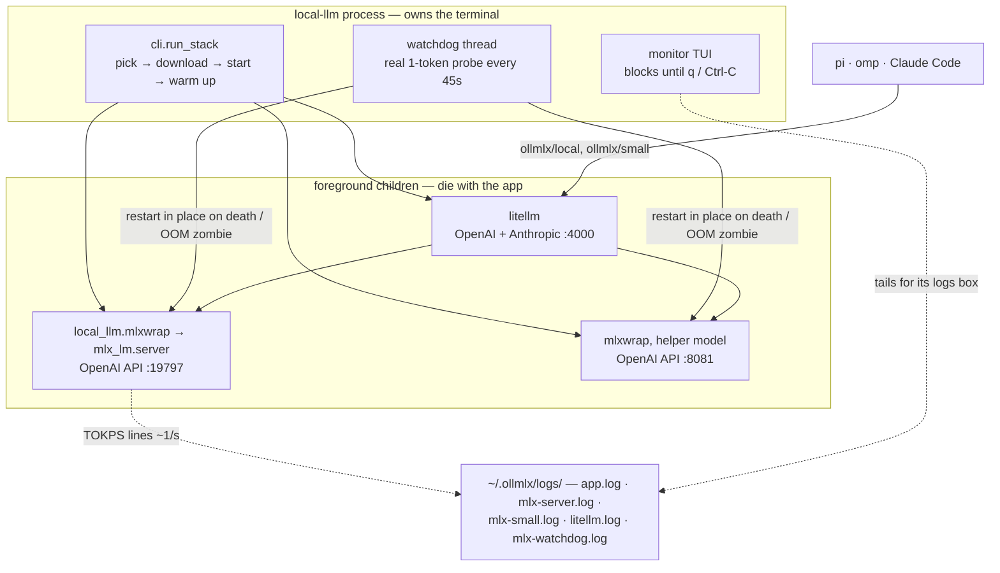

# local-llm

One command to run a local LLM on your Mac: pick a model that fits your RAM,
download it, serve it via OpenAI-compatible and Anthropic-compatible APIs, and
point your AI coding tools (`pi`, `omp`, Claude Code) at it.

```console
$ local-llm
```

```
 model picker — RAM 128GB · Apple M5 Max · sort: by score (s — toggle)
── 💿 Installed (✓ ready · ⬇ downloading) ─────────────────────────────────────
▸  ⬇ Litwein/Qwen3.8-Flash-Next-REAP320-oQ3e-DWQ-MTP-Vision-MLX ⚡98 · 14.0G so far · ~16GB RAM · ctx 262K
   ✓ mlx-community/Qwen3.5-122B-A10B-4bit ★  ⚡91 · 64.8G on disk · ~75GB RAM · MoE · ↓5K · ⭐21 · ctx 262K
   ⬇ mlx-community/GLM-4.5-Air-4bit                          ⚡79 · 54.6G so far · ~63GB RAM · ↓2K · ⭐29 · ctx 131K
── ☁ HuggingFace · mlx-community · by score ───────────────────────────────────
    mlx-community/gemma-4-12B-it-qat-4bit                   ⚡97 · ~8GB RAM · ↓24K · ⭐29 · ctx 262K
    mlx-community/gemma-4-12b-coder-fable5-composer2.5-8bit ⚡97 · ~15GB RAM · ↓2K · ⭐37 · ctx 262K
 ⚡98.2 = quality 96 · speed 100 (53 tok/s) · fit 100 · ctx 100 · ~78GB of 128GB · Multimodal · ⬇ ~18%
 j/k↑↓ PgUp/PgDn g/G · / search · l more · s sort · f MLX⇄GGUF · a all⇄community · d delete · Enter select · q cancel
```

Behind the scenes it starts the model server (**mlx_lm.server** for MLX
models, **llama-server** from llama.cpp for GGUF ones; OpenAI API on
`:19797`) and a **litellm** proxy (`:4000`) that adds an Anthropic
`/v1/messages` endpoint, so Claude Code can talk to the same local model.
Both run as foreground children: quitting the monitor (or Ctrl-C) stops
everything — no daemons left behind.

**Contents:** [Features](#features) · [Requirements](#requirements) ·
[Install](#install) · [Usage](#usage) · [Configuration](#configuration) ·
[Files](#files) · [Troubleshooting](#troubleshooting) ·
[How it works](#how-it-works) · [Project layout](#project-layout) ·
[License](#license)

## Features

- **Model picker (TUI)** — installed models first: `✓` ready (green) and
  `⬇` still downloading in another session (yellow, live "14.0G so far"
  — Enter resumes it; finished blobs are reused). Both kinds of
  row carry the full llmfit field set — disk size, RAM estimate (from
  the weights on disk), MoE, downloads/likes, context, tools — then the
  catalog candidates ranked by score. `d` on an installed row deletes
  it from disk (y/n confirm; frees the shared cache blobs). Models that
  won't fit your RAM are
  marked `⚠won't fit`. Press `a` to switch between the curated
  `mlx-community` org and **all MLX-format models** (any author —
  includes fresh personal re-quants); `/`-search queries HuggingFace
  server-side, so models beyond the loaded pages are findable too.
- **Readable download progress** — a single status line with a progress bar,
  percent, speed, ETA and the current file (native huggingface_hub's three
  interleaved tqdm bars are disabled).
- **API bridge** — OpenAI `/v1/chat/completions` and Anthropic `/v1/messages`
  on one port, model exposed under a stable alias `ollmlx/local`.
- **Fast helper model** — a second tiny model (default
  `Qwen3-0.6B-4bit`, ~0.5GB / ~1GB RAM, negligible GPU) served on its own
  port as `ollmlx/small`. Claude Code's background calls (session titles
  and other haiku-slot traffic) use it via `ANTHROPIC_SMALL_FAST_MODEL` —
  they have a short fixed timeout and used to die queued behind the big
  model's generation. The auto-mode Bash safety classifier is a separate
  path: on non-Anthropic providers it deliberately runs on the session
  model over a trimmed transcript, so its first call after the context
  grows pays the prefill delta — a retry succeeds once it's cached
  (keeping long sessions `/compact`ed helps). omp's `smol` model role is
  pinned to it in
  `~/.omp/agent/config.yml` (commit messages, memory notes, `--prewalk` /
  `--plan-yolo` execution all route through that role). pi (v1.0.x) has no
  role harness — there `ollmlx/small` is a plain catalog entry
  (`--model ollmlx/small`, or `/model` in-session). If the helper can't be
  downloaded, the stack degrades to everything-on-the-big-model instead of
  failing.
- **Client config writer** — registers the model in `pi` and `omp` model
  catalogs, merges an `ollmlx` provider into opencode's global config
  (other keys preserved; `small_model` pinned to the helper when that slot
  is free), and generates a Claude Code settings file. The advertised
  `contextWindow` is the KV-safe budget (prompt-cache bound, ~10%
  headroom), not the config.json maximum — pi/omp compact *before* the
  model dies. A session that outgrows the budget anyway is trimmed
  server-side: the oldest messages are dropped (system prompt and a fresh
  tail starting on a user message always survive), the request is served,
  and the trim is logged. Only an unsplittable request (one message over
  the whole budget) gets a clean "context too long" refusal — the Metal
  OOM that used to kill the generation thread can't happen.
- **System monitor** — htop-style curses UI: the model's live tokens/sec
  (decode rate + a history graph, prefill rate while it reads your prompt),
  per-core CPU + history graph, RAM/swap, server status, process RSS,
  recent errors from the logs.
- **llmfit stats & score** — context length, tool-use capability and a RAM
  estimate for exotic quantization names next to each model in the picker,
  plus the **llmfit composite score** (a Python port of llmfit's fit
  calculator, Apache-2.0): quality × speed × memory-fit × context, weighted
  per use case and keyed to *your* chip's memory bandwidth. The list is the
  whole cached catalog ranked by that score, so the top of the list is
  llmfit's #1 for your machine (`a` widens it from `mlx-community` to all
  MLX authors) — and it renders instantly, offline: the weekly cache is
  enough for browsing, only `/`-search asks HuggingFace about models newer
  than the catalog. The row under the cursor gets a one-line breakdown
  (`⚡98.2 = quality 96 · speed 100 (53 tok/s) · …`), installed models
  included. Sourced from the [llmfit](https://github.com/AlexsJones/llmfit)
  model catalog (MLX-format slice, cached for a week in `~/.ollmlx`).
  After `Enter` a fullscreen startup dialog takes over — spinner + live
  boot log (download progress, server readiness) instead of scrolling
  text — and hands off straight to the monitor.
- **Self-healing watchdog** — a thread probes the big model with a real
  1-token completion every 45s (`/v1/models` stays 200 even when the
  generation thread is dead, so health is measured by generating). A dead
  process or two failed probes — the post-OOM zombie: a Metal OOM kills
  the generation thread and every completion 404s until restart — gets
  both mlx servers restarted in place; litellm and clients keep pointing
  at the same ports and just see a pause. Restart events appear in
  `~/.ollmlx/logs/mlx-watchdog.log` (the monitor shows them too). 3 restarts in
  10 minutes — a client session bigger than the machine can serve,
  resending its full context after every restart — switch the watchdog
  to a probe every 10 min with a note to compact the session; restarts
  continue, normal cadence resumes once the crashes age out.
- **HF token support** — for gated models and API limits; stored outside the
  repo in `~/.ollmlx/hf-token` (chmod 600).
- **DoH-pinned DNS** — resolves `*.hf.co` via 1.1.1.1 when your TUN proxy
  hands out fake IPs and downloads die on TLS (see [Troubleshooting](#troubleshooting)).

## Requirements

- macOS on Apple Silicon (MLX runs only on M-series chips)
- [`uv`](https://docs.astral.sh/uv/) (`curl -LsSf https://astral.sh/uv/install.sh | sh`)

That's the only manual prerequisite — Python itself and all dependencies are
installed automatically (see below). Run it and pick a model — no
configuration decisions needed.

## Install

### Homebrew

```console
$ brew tap mukhanov/local-llm
$ brew install local-llm
```

Apple Silicon only (MLX). Models, the venv and logs live in `~/.ollmlx`
and `~/.cache/huggingface` regardless of how you installed; `brew
upgrade` picks up new releases.

### From a git checkout

From a git checkout — the launcher bootstraps everything on first run:

```console
$ git clone https://github.com/<you>/local-llm.git
$ cd local-llm
$ ./local-llm                 # creates the venv, installs deps, opens the picker
```

To have `local-llm` on your PATH, symlink the launcher:

```console
$ mkdir -p ~/bin && ln -s "$PWD/local-llm" ~/bin/local-llm   # if ~/bin is in PATH
```

Prefer standard tooling? The package is installable too:

```console
$ uv tool install .           # or: pipx install .
$ local-llm
# or run straight from the checkout without installing:
$ uv run local-llm
```

### Dependencies

Dependencies are declared once, in [`pyproject.toml`](pyproject.toml):
`mlx-lm` (pulls in MLX for your chip), `huggingface-hub`, `psutil`.
Nothing is installed globally:

| What                | Where                          | Installed when              |
|---------------------|--------------------------------|-----------------------------|
| Python 3.12         | managed by uv, if none found   | first run (`uv venv`)       |
| local-llm + deps    | `~/.ollmlx/venv` (editable)    | first run and whenever `pyproject.toml` changes |
| `litellm`           | uv tool (`~/.local/...`)       | first stack start, if missing |

The launcher reinstalls dependencies only when `pyproject.toml` changes, so
regular launches don't touch the network. `git pull` picks up code changes
immediately thanks to the editable install.

## Usage

```console
$ local-llm                     # interactive picker + monitor
$ local-llm mlx-community/Qwen3-30B-A3B-Instruct-2507-4bit
$ local-llm ggml-org/Qwen3-0.6B-GGUF            # GGUF: llama.cpp backend
$ local-llm ggml-org/Qwen3-0.6B-GGUF Q4_K_M     # GGUF: pick the quant file
$ local-llm list                # downloaded models: disk size, RAM, MoE, ctx, score
$ local-llm serve org/model     # headless stack: no TUI, stop with SIGTERM
$ local-llm rm                  # delete downloaded models (menu)
$ local-llm stop                # kill servers left over from a crashed run
$ local-llm token hf_xxx        # save HF token (or export HF_TOKEN)
$ local-llm token --clear
```

`serve` boots the same stack (servers + watchdog, no monitor) and blocks
until SIGTERM/SIGINT — for bots and launchd jobs that need the model only
for a while; a port collision exits non-zero without touching a foreign
stack.

### GGUF models (llama.cpp)

GGUF repos (`…-GGUF`) run on **llama-server** from
[llama.cpp](https://github.com/ggml-org/llama.cpp) instead of `mlx_lm.server`
— same ports, same litellm proxy, same client configs and monitor. A GGUF
repo holds many quant files (Q2_K … Q8_0); local-llm auto-picks the largest
one that fits your free RAM with headroom (or the one you name:
`local-llm org/repo Q4_K_M`, any substring works) and downloads **only that
file**. Split GGUFs (`-00001-of-00003`) are grouped and fetched as one;
`imatrix` / `mmproj` / `-mtp-` draft files are skipped. The context window
and KV math come from a minimal GGUF-header parser, so the same
prompt-cache/KV clamps and client `contextWindow` advertised values apply.
`f` in the picker toggles MLX ⇄ GGUF browsing.

The llama-server binary is auto-downloaded from llama.cpp's GitHub releases
(macOS arm64 build, ~16MB) into `~/.ollmlx/llama.cpp/llama-b<N>/` and pinned
there — no silent upgrades, a re-download only when the pin is missing.
Point `OLLMLX_LLAMA_SERVER` at your own binary to use that instead.

While the stack is up:

| Client      | Command                                        |
|-------------|------------------------------------------------|
| pi          | `pi --model ollmlx/local`                      |
| omp         | `omp --model ollmlx/local`                     |
| OpenCode    | `opencode --model ollmlx/local`                |
| Claude Code | `claude --settings ~/.ollmlx/claude-local.json` |

Or talk to the API directly (both endpoints on the litellm port `:4000`):

```console
$ curl http://127.0.0.1:4000/v1/chat/completions \
    -H "Authorization: Bearer sk-local-llm" -H "Content-Type: application/json" \
    -d '{"model": "local", "messages": [{"role": "user", "content": "hi"}]}'

$ curl http://127.0.0.1:4000/v1/messages \
    -H "x-api-key: sk-local-llm" -H "Content-Type: application/json" \
    -d '{"model": "local", "max_tokens": 64, "messages": [{"role": "user", "content": "hi"}]}'
```

### Picker keybindings

| Key            | Action                                  |
|----------------|-----------------------------------------|
| `j/k` `↑/↓`    | move (past the end — load more from HF) |
| `PgUp/PgDn` `space` | page                                |
| `g` / `G`      | top / bottom                            |
| `/`            | search (Enter also queries HF server-side) |
| `l`            | load next page from HuggingFace         |
| `s`            | sort: hardware fit ⇄ downloads          |
| `a`            | catalog: `mlx-community` ⇄ all MLX models |
| `d`            | delete selected installed model (the 🔒 helper is protected) |
| `Enter`        | select and run                          |
| `q` `Esc`      | cancel                                  |

### Monitor

Two **tokens/sec** graphs side by side — the big model and the helper,
each with its own scale (30 vs 300 tok/s would flatten each other on a
shared axis): current decode rate, history graph, the prompt-processing
rate while it prefill-reads your prompt, and a one-line summary of the
last completion. Below them, in a grid: CPU with a history graph on the
left and the per-core grid on the right, then the client launch commands
on the left and mlx/litellm process stats on the right (each with its
share of RAM, plus a ledger line: the stack's total vs the rest of the
machine and what's still available), then the RAM/swap bars — and at the
very bottom a full-width box with the latest errors and log tails from
`~/.ollmlx/logs/mlx-server.log`, `~/.ollmlx/logs/mlx-small.log` and
`~/.ollmlx/logs/litellm.log` (GGUF stacks tail `llama-server.log`
instead of the mlx log); the
box grows with the terminal and its tail hugs the bottom border. The two
graphs and all boxes follow the same left/right column grid. The logs
scroll — the mouse wheel / trackpad scroll, `↑/↓` line by line,
`PgUp/PgDn` by pages, the frame title shows
the distance from live, `End`/`G` returns to the tail. When free memory
drops under 10 GB the MEM bar pulses red with an `⚠ OOM risk` warning
(that pressure is what OOMs the model), and a `top mem (kill <pid>)`
line names the heaviest third-party apps. Press `q`
(or Ctrl-C) to stop the whole stack.

The tok/s numbers come from a thin wrapper around `mlx_lm.server`
(`local_llm.mlxwrap`): it counts generated tokens and logs `TOKPS` lines
once a second — the monitor graphs them. GGUF stacks have no wrapper;
there the monitor parses llama-server's per-request perf lines instead
(one rate per completed request, no live ~1/s ticks).

The terminal tab is owned by the app from the moment it launches: `🟢
ollmlx` while you pick, `🟡 <model>` in the startup dialog, then the
monitor keeps it updated — load circle (green/yellow/red by max(CPU%,
RAM%), the memory pressure being what kills the model), model name and
the models' live RAM (`🟢 <model> · 65G`). Quitting hands the original
title back.

## Configuration

All via environment variables:

| Variable                 | Default                        | Meaning |
|--------------------------|--------------------------------|---------|
| `MLX_PORT`               | `19797`                        | mlx_lm.server port (OpenAI API) |
| `LITELLM_PORT`           | `4000`                         | litellm proxy port (OpenAI + Anthropic) |
| `OLLMLX_SMALL_MODEL`     | `mlx-community/Qwen3-0.6B-4bit` | tiny helper model for fast/background calls; marked 🔒 in lists and protected from deletion |
| `MLX_SMALL_PORT`         | `8081`                         | helper model port (`ollmlx/small`) |
| `MLX_KV_BITS`            | `0`                            | KV quantization; breaks prompt-cache hits on long contexts — only for ~100G models. GGUF: `8` maps to llama-server's q8_0 KV cache |
| `MLX_KV_GROUP_SIZE`      | `64`                           | KV-cache group size |
| `MLX_PROMPT_CACHE_BYTES` | `17179869184`                  | prompt-cache cap (16GB ≈ 136k tokens on the 122B), `0` = unlimited |
| `MLX_MAX_CTX`            | `110000`                       | hard context ceiling (tokens): advertised to clients so they compact early, enforced by the server as a clean "context too long" refusal; `0` = KV-budget only |
| `LOAD_TIMEOUT`           | `900`                          | seconds to wait for weights to load |
| `OLLMLX_LLAMA_SERVER`    | —                              | your own llama-server binary for GGUF models (default: managed download into `~/.ollmlx/llama.cpp`, pinned to one build) |
| `OLLMLX_HOME`            | `~/.ollmlx`                    | venv, litellm config, token, claude config |
| `HF_HUB_CACHE`           | `~/.cache/huggingface/hub`     | model cache path |
| `HF_TOKEN`               | —                              | HuggingFace token (or `local-llm token`) |

KV quantization matters on big models: long prompts (~30k tokens) with a full
16-bit cache can exhaust RAM on a model that "fits", which kills the Metal
generation thread — 8-bit keeps a 100GB-class model stable in 128GB RAM.

## Files

| Path                                  | Purpose |
|---------------------------------------|---------|
| `~/.ollmlx/venv`                      | isolated Python environment |
| `~/.ollmlx/hf-token`                  | HF token, chmod 600 |
| `~/.ollmlx/llama.cpp/`                | llama-server binaries (GGUF backend, one pinned build) |
| `~/.ollmlx/litellm-config.yaml`       | generated proxy config |
| `~/.ollmlx/claude-local.json`         | Claude Code settings |
| `~/.ollmlx/logs/*.log`                | app + server logs (`app.log` — the app's own, with crash tracebacks; `.log.1` — the previous run) |
| `~/.pi/agent/models.json`             | `pi` model catalog (merged) |
| `~/.omp/agent/models.json`            | `omp` model catalog (merged) |
| `~/.config/opencode/opencode.json`    | `opencode` global config (ollmlx provider merged in) |
| `~/.cache/huggingface/hub`            | downloaded models |

Deleting models (`local-llm rm`) is aware of the hub 1.x shared blob store
(`hub/blobs/<xx>/<sha>`): it frees the real weights and never touches blobs
shared with another downloaded model.

## Troubleshooting

- **Downloads hang / TLS errors on `*.hf.co`** — typically a TUN-mode proxy
  (fake-ip DNS) breaking name resolution. local-llm resolves HuggingFace hosts
  via DoH (1.1.1.1) and pins the result for the session. Plain `curl` from the
  same machine may still fail — that's expected.
- **Model dies overnight (404s to everything)** — a Metal OOM: the session
  grew past the prompt-cache ceiling (16GB ≈ 184k tokens on the 122B-class
  models; seen with a 186,688-token prompt) and the next cache extension
  failed the GPU command buffer. Three defenses now: the advertised
  context is capped (MLX_MAX_CTX, default 110k) so clients compact early;
  a session over the budget is trimmed server-side (oldest messages
  dropped, the request still served — watch for "context trimmed" in the
  logs); and the watchdog restarts the model within ~1.5 minutes if it
  dies anyway, backing off if it dies repeatedly. The crashed run's log
  is `~/.ollmlx/logs/mlx-server.log.1`; the app's own trail (crash
  tracebacks included) is `~/.ollmlx/logs/app.log`.
- **Server didn't start** — check `~/.ollmlx/logs/mlx-server.log` and
  `~/.ollmlx/logs/litellm.log`
  (`.log.1` holds the previous run's tail — the crash before this one);
  `local-llm stop` cleans up leftover processes.
- **Interrupted download** — weight files (any LFS file ≥1GiB: safetensors
  shards, GGUF quants) are fetched with plain Range requests and resume
  from the bytes already on disk across runs; a killed hub download's
  partial is adopted after a content check, and each finished file is
  sha256-verified before it's linked into the cache. Small files go
  through huggingface_hub, which does not resume across runs — stale
  leftovers are pruned, finished blobs reused, the rest re-downloaded —
  so a half-downloaded model never silently "serves".
- **Wrong model picked by the fit score** — press `s` to sort by downloads, or
  `/` to search, or just pass the full `org/repo` on the command line.

## How it works

One process, three children, one terminal:



The stack boots in a worker thread behind the fullscreen startup dialog,
then hands the terminal to the monitor. Everything the app itself does —
lifecycle events, spawn commands, watchdog restarts, and any crash
traceback (main thread, background thread, or SIGTERM) — lands in
`~/.ollmlx/logs/app.log`; each server child keeps its own log next to it,
with `.log.1` holding the previous run.

## Project layout

```
local-llm            sh launcher: venv bootstrap from pyproject, then exec
pyproject.toml       dependencies, entry point, metadata (single source)
local_llm/
  cli.py             commands and orchestration: pick → download → start → monitor
  config.py          env-driven settings (ports, paths, memory budgets)
  applog.py          persistent app log + crash/signal hooks
  ui.py              colored output, locale/term fixes, hardware info
  picker.py          curses model picker (TUI + plain fallback)
  startup.py         fullscreen boot dialog (spinner + live boot log)
  monitor.py         htop-style curses monitor (tok/s, CPU, RAM, log tails)
  servers.py         mlx/litellm lifecycle: spawn, readiness, warmup, watchdog
  mlxwrap.py         mlx_lm.server entry wrapper: tok/s lines + context guard
  clients.py         pi / omp / Claude Code config writer
  hf.py              HuggingFace: DoH DNS, catalog API, cache, download/delete
  models.py          model-name parsing, RAM estimates, hardware-fit scoring
  llmfit.py          llmfit catalog cache + composite score port
  vendor/            model impls ahead of mlx_lm releases (registered only
                     when the installed mlx_lm lacks the module)
```

Module names are part of the process contract: children are spawned as
`python -m local_llm.mlxwrap` and swept with `pkill -f local_llm.mlxwrap`
— renaming a module means updating the spawn commands and match patterns
in `servers.py`/`monitor.py` too. Development notes for coding agents
live in [AGENTS.md](AGENTS.md).

## License

[MIT](LICENSE)
